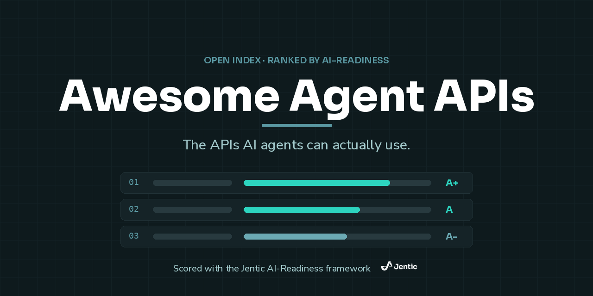

<p align="center">
  
</p>

<p align="center">
  <a href="https://awesome.re"></a>
  <a href="CONTRIBUTING.md"></a>
  <a href="CODE_OF_CONDUCT.md"></a>
</p>

<p align="center">
  <a href="https://discord.com/invite/TdbWXZsUSm"></a>
  <a href="https://x.com/JenticAI"></a>
  <a href="https://www.linkedin.com/company/jentic/"></a>
</p>

> The APIs AI agents reach for most, and how usable each one actually is from its OpenAPI spec, scored with the open [Jentic API AI-Readiness Framework](https://github.com/jentic/api-ai-readiness-framework).

A valid OpenAPI spec doesn't mean an agent can use it. Most specs were written for human developers reading docs, not for an agent reasoning about operations on its own. This list is a collection of the APIs agents need most, split into the ones a spec can carry today and the essential ones whose specs still make an agent work harder. Every entry links straight to the standardised spec in the [Jentic API Directory](https://github.com/jentic/jentic-public-apis).

## Why this matters even in the age of MCPs

The obvious objection: *if an API matters, someone builds an MCP for it, so who cares about the raw spec?*

Three reasons. **MCPs cover dozens of APIs; there are 100,000+ in the wild.** Your agent will hit ones that have none. **An MCP exposes a hand-picked slice:** 15–30 tools out of hundreds of endpoints, and the rest lives only in the spec. And **coding agents read specs directly:** when Claude Code or Cursor writes an integration, it's interpreting the OpenAPI document, not calling an MCP.

Then the case that settles it: **your own internal APIs will never get an MCP.** A team with 50 internal services has 50 specs and no shortcuts. Stripe can afford to build an MCP to make up for a hard-to-parse spec. You can't do that for every service your team maintains, so the spec has to carry the agent on its own.

## How we score

We report two dimensions from the [JAIRF framework](https://github.com/jentic/api-ai-readiness-framework): the two that answer "can an agent use this API from its spec?" Both are scored 0-100. We don't combine them into one number; we show both, because they tell different stories.

| Signal | What it measures |
|--------|-----------------|
| **Agent Usability** | How much structural complexity an agent has to handle: endpoint count and schema depth. Small, focused APIs with shallow schemas score highest. |
| **AI-Readiness** | Can an agent *understand* what the API does? Description coverage, semantic richness, operation-ID quality, summary clarity. |

A note on the numbers: Agent Usability peaks at 93.7. That is the ceiling for an API with no meaningful structural complexity (roughly under 50 operations, shallow schemas), and many well-designed, focused APIs earn exactly that ceiling, which is why you will see it repeatedly in the Agent-ready tier. AI-Readiness varies more between APIs, so it is usually the differentiator.

The framework's other four dimensions (Security, Compliance, Developer Experience, Discoverability) matter for governance and tooling, but they don't tell you whether an agent can read and operate the API. That's what these two do.

**How an API gets on this list:**
- **Agent-ready:** scores strongly on at least one signal, with the other in usable range.
- **Essential, harder for agents:** widely needed by agents regardless of score, shown with honest numbers so you know where the friction is. This is where a standardised, agent-ready spec earns its keep.

## Contents

- [Agent-ready](#agent-ready)
  - [AI & LLM Providers](#ai--llm-providers)
  - [Search & Recommendations](#search--recommendations)
  - [Project Management & Productivity](#project-management--productivity)
  - [Cloud Infrastructure & DevOps](#cloud-infrastructure--devops)
  - [Databases & Data Platforms](#databases--data-platforms)
  - [Communication & Email](#communication--email)
  - [Monitoring & Observability](#monitoring--observability)
  - [Auth & Identity](#auth--identity)
  - [Storage & Content](#storage--content)
  - [Music & Media](#music--media)
- [Essential, but harder for agents](#essential-but-harder-for-agents)
- [Use these APIs with your agent](#use-these-apis-with-your-agent)
- [Score your own APIs](#score-your-own-apis)

---

# Agent-ready

APIs whose specs an agent can read and operate today. Names link to the standardised spec in the Jentic API Directory.

## AI & LLM Providers

| API | What your agent can do with it | Agent Usability | AI-Readiness |
|-----|--------------------------------|----------------:|-------------:|
| [Anthropic API](https://github.com/jentic/jentic-public-apis/tree/main/apis/openapi/anthropic.com/anthropic-api/2024-10-22) | Generate text and run tool-use loops with Claude models; batch and stream messages | 93.5 | 48.3 |
| [Groq API](https://github.com/jentic/jentic-public-apis/tree/main/apis/openapi/groq.com/main/1.0) | Run low-latency LLM inference: chat completions and audio transcription | 93.7 | 49.5 |
| [Amazon Bedrock Runtime](https://github.com/jentic/jentic-public-apis/tree/main/apis/openapi/amazonaws.com/bedrock-runtime/2023-09-30) | Invoke and stream foundation models with guardrails and multi-turn conversation | 93.7 | 47.7 |
| [OpenAI API](https://github.com/jentic/jentic-public-apis/tree/main/apis/openapi/openai.com/main/2.3.0) | Chat, audio, embeddings, assistants, and image generation across OpenAI models | 76.5 | 48.2 |
| [Cohere API](https://github.com/jentic/jentic-public-apis/tree/main/apis/openapi/cohere.com/main/1.0) | Generate text, create embeddings, and rerank results for search and RAG | 93.7 | 30.8 |

## Search & Recommendations

| API | What your agent can do with it | Agent Usability | AI-Readiness |
|-----|--------------------------------|----------------:|-------------:|
| [Algolia Insights](https://github.com/jentic/jentic-public-apis/tree/main/apis/openapi/algolia.com/algolia-insights-api/1.0.0) | Send click, conversion, and view events to train relevance and personalization | 93.7 | 62.3 |
| [Algolia Recommend](https://github.com/jentic/jentic-public-apis/tree/main/apis/openapi/algolia.com/algolia-recommend-api/1.0.0) | Return related-item and frequently-bought-together recommendations | 93.7 | 57.5 |
| [Algolia Ingestion](https://github.com/jentic/jentic-public-apis/tree/main/apis/openapi/algolia.com/algolia-ingestion-api/1.0.0) | Connect sources and schedule data imports into Algolia indexes | 92.3 | 56.4 |
| [Algolia Search](https://github.com/jentic/jentic-public-apis/tree/main/apis/openapi/algolia.com/algolia-search-api/1.0.0) | Query indexes for ranked, typo-tolerant results with faceting and filtering | 89.5 | 54.0 |

## Project Management & Productivity

| API | What your agent can do with it | Agent Usability | AI-Readiness |
|-----|--------------------------------|----------------:|-------------:|
| [ClickUp API](https://github.com/jentic/jentic-public-apis/tree/main/apis/openapi/clickup.com/clickup-api/2.0) | Create and update tasks, lists, and docs; track time and manage workspaces | 93.7 | 55.7 |
| [Figma REST API](https://github.com/jentic/jentic-public-apis/tree/main/apis/openapi/figma.com/figma-rest-api/1.0.0) | Read file contents, export images, and pull comments and component metadata | 93.7 | 50.2 |
| [Linear API](https://github.com/jentic/jentic-public-apis/tree/main/apis/openapi/linear.app/main/1.0) | Create and update issues, projects, and cycles; query teams and states | 93.7 | 45.3 |
| [Airtable Web API](https://github.com/jentic/jentic-public-apis/tree/main/apis/openapi/airtable.com/main/0.1.0) | Read and write records, fields, and tables across bases | 93.7 | 43.1 |

## Cloud Infrastructure & DevOps

| API | What your agent can do with it | Agent Usability | AI-Readiness |
|-----|--------------------------------|----------------:|-------------:|
| [AWS Lambda](https://github.com/jentic/jentic-public-apis/tree/main/apis/openapi/amazonaws.com/aws-lambda-api/2015-03-31) | Create, invoke, and manage serverless functions and their event triggers | 93.7 | 54.7 |
| [Docker Engine API](https://github.com/jentic/jentic-public-apis/tree/main/apis/openapi/docker.com/engine/1.33) | Build, run, and manage containers, images, networks, and volumes | 83.2 | 48.4 |
| [AWS Step Functions](https://github.com/jentic/jentic-public-apis/tree/main/apis/openapi/amazonaws.com/states/2016-11-23) | Orchestrate multi-step workflows as state machines across AWS services | 93.7 | 37.0 |
| [Amazon EKS](https://github.com/jentic/jentic-public-apis/tree/main/apis/openapi/amazonaws.com/eks/2017-11-01) | Provision and manage Kubernetes clusters, node groups, and add-ons | 93.7 | 38.9 |

## Databases & Data Platforms

| API | What your agent can do with it | Agent Usability | AI-Readiness |
|-----|--------------------------------|----------------:|-------------:|
| [Supabase Management API](https://github.com/jentic/jentic-public-apis/tree/main/apis/openapi/supabase.com/main) | Provision and configure Supabase projects, databases, and auth settings | 93.7 | 54.6 |
| [Neon API](https://github.com/jentic/jentic-public-apis/tree/main/apis/openapi/neon.tech/main) | Provision serverless Postgres projects, branches, and database endpoints | 71.9 | 53.3 |
| [Public Records MCP](https://github.com/GeminiGeorge22/publicrecords-mcp) | 18 Apify-hosted MCP servers for public data: SAM.gov, Grants.gov, USAspending, EU TED and UK tenders, city council meetings, Ashby/Greenhouse/Lever/SmartRecruiters jobs, company social links, Google Ads Transparency, Etsy sales, sports odds, Spotify play counts |  |  |

## Communication & Email

| API | What your agent can do with it | Agent Usability | AI-Readiness |
|-----|--------------------------------|----------------:|-------------:|
| [SendGrid Mail API](https://github.com/jentic/jentic-public-apis/tree/main/apis/openapi/sendgrid.com/mail) | Send transactional and marketing email and track delivery events | 93.7 | 41.4 |
| [Resend](https://github.com/jentic/jentic-public-apis/tree/main/apis/openapi/resend.com/main) | Send transactional email and manage domains, audiences, and broadcasts | 91.0 | 31.6 |

## Monitoring & Observability

| API | What your agent can do with it | Agent Usability | AI-Readiness |
|-----|--------------------------------|----------------:|-------------:|
| [Sentry API](https://github.com/jentic/jentic-public-apis/tree/main/apis/openapi/sentry.io/main) | Query issues and events, manage projects, and track release health | 93.7 | 59.1 |

## Auth & Identity

| API | What your agent can do with it | Agent Usability | AI-Readiness |
|-----|--------------------------------|----------------:|-------------:|
| [Auth0 Authentication API](https://github.com/jentic/jentic-public-apis/tree/main/apis/openapi/auth0.com/main/2.0.0) | Authenticate users, exchange tokens, and run OAuth and passwordless flows | 93.7 | 48.9 |

## Storage & Content

| API | What your agent can do with it | Agent Usability | AI-Readiness |
|-----|--------------------------------|----------------:|-------------:|
| [Contentful Images API](https://github.com/jentic/jentic-public-apis/tree/main/apis/openapi/contentful.com/main/1.0.0) | Transform, resize, and reformat images served from Contentful | 93.7 | 48.7 |
| [Dropbox API v2](https://github.com/jentic/jentic-public-apis/tree/main/apis/openapi/dropbox.com/dropbox-api-v2/2.0.0) | Upload, download, share, and manage files and folders | 89.5 | 46.9 |

## Music & Media

| API | What your agent can do with it | Agent Usability | AI-Readiness |
|-----|--------------------------------|----------------:|-------------:|
| [Spotify Web API](https://github.com/jentic/jentic-public-apis/tree/main/apis/openapi/spotify.com/sonallux) | Search tracks, manage playlists, and read playback and library data | 87.2 | 54.4 |

---

# Essential, but harder for agents

These are APIs agents reach for constantly, and their specs score low on one or both signals. They're not bad APIs; they're large, mature, and specced for human developers, not for an agent reading them cold. Your agent will need them anyway. The score tells you where the friction is, and it's exactly here that a standardised, agent-ready spec (and an execution layer that handles the spec for you) does the most work.

| API | What your agent needs it for | Agent Usability | AI-Readiness | Why it's hard |
|-----|------------------------------|----------------:|-------------:|---------------|
| [Stripe API](https://github.com/jentic/jentic-public-apis/tree/main/apis/openapi/stripe.com/main/2025-03-31.basil) | Process payments, manage subscriptions and invoices, issue refunds | 42.6 | 48.9 | 600+ endpoints, a huge surface to reason over |
| [GitHub REST API](https://github.com/jentic/jentic-public-apis/tree/main/apis/openapi/github.com/api.github.com/1.1.4) | Manage repos, issues, pull requests, actions, and releases | 42.6 | 18.2 | 900+ endpoints, minimal descriptions |
| [Slack Web API](https://github.com/jentic/jentic-public-apis/tree/main/apis/openapi/slack.com/main/1.7.0) | Post messages, manage channels, respond to events | 57.9 | 27.5 | Sparse descriptions, low semantic clarity |
| [Notion API](https://github.com/jentic/jentic-public-apis/tree/main/apis/openapi/notion.com/notion-api/2026-03-11) | Create and query pages, databases, and blocks | 21.1 | 51.3 | Complex nested-object model |
| [Shopify Admin API](https://github.com/jentic/jentic-public-apis/tree/main/apis/openapi/shopify.com/main/2025-01) | Manage products, orders, customers, and inventory | 42.6 | 51.8 | Large surface, limited per-operation context |
| [Gmail API](https://github.com/jentic/jentic-public-apis/tree/main/apis/openapi/googleapis.com/gmail/v1) | Read, send, and organize email; manage labels and threads | 89.3 | 6.7 | Operable, but almost no semantic description |
| [Twilio Messaging](https://github.com/jentic/jentic-public-apis/tree/main/apis/openapi/twilio.com/twilio_messaging_v1) | Send and receive SMS, MMS, and WhatsApp messages | 92.8 | 37.7 | Strong usability, thin descriptions |
| [Intercom API](https://github.com/jentic/jentic-public-apis/tree/main/apis/openapi/intercom.com/main/2.13) | Manage conversations, contacts, and help articles | 73.9 | 47.1 | Borderline, close to the top tier |

---

## Use these APIs with your agent

Every API here is in the [Jentic API Directory](https://github.com/jentic/jentic-public-apis). To give your agent access to any of them without hardcoding credentials or writing glue code, use **[Jentic Mini](https://github.com/jentic/jentic-mini)**, a self-hosted execution layer that sits between your agent and the API.

```bash
docker run -d --name jentic-mini -p 8900:8900 -v jentic-mini-data:/app/data jentic/jentic-mini
```

Your agent says what it wants to do. Jentic Mini handles the how: finding the right operation, injecting credentials at runtime, brokering the request. Secrets never touch the agent.

- **7,400+ APIs** from the directory, available once you add credentials
- **Credential vault:** keys and OAuth tokens stored encrypted, injected at execution time
- **Toolkits:** scoped, individually revocable access per agent
- **No glue code:** your agent searches by intent, and Jentic Mini executes

This is the answer to the "Essential, but harder for agents" tier above: the hard specs are hard *for the agent*. Jentic Mini reads them so your agent doesn't have to.

[Get started →](https://github.com/jentic/jentic-mini)

## Score your own APIs

The scores here come from an open framework you can run on any spec, including your private internal ones.

**Online:** upload an OpenAPI spec at **[jentic.com/scorecard](https://jentic.com/scorecard)** for an assessment across all six JAIRF dimensions.

**CLI (local, nothing sent to Jentic):**
```bash
npx @jentic/api-scorecard-cli@latest score <path-or-url-to-openapi-spec>
```

**Learn more:**
- [API AI-Readiness Framework](https://github.com/jentic/api-ai-readiness-framework)
- [Jentic API Scorecard (CLI source)](https://github.com/jentic/jentic-api-scorecard)

---

## About

Maintained by [Jentic](https://jentic.com), sourced from the [Jentic API Directory](https://github.com/jentic/jentic-public-apis), 7,400+ APIs scored for AI-agent readiness. Scores are generated by the [Jentic API Scorecard](https://github.com/jentic/jentic-api-scorecard) using the [JAIRF specification](https://github.com/jentic/api-ai-readiness-framework). We report Agent Usability and AI-Readiness because they measure whether an agent can read and operate an API from its spec.

## Contributing

See [CONTRIBUTING.md](CONTRIBUTING.md) for how to suggest an API or flag a score.

## License

Content licensed under [CC BY 4.0](https://creativecommons.org/licenses/by/4.0/): use it, share it, build on it, with attribution.

© 2026 Jentic.

<!-- jentic:discovery
search_terms: best apis for ai agents, agent-ready apis, openapi for llm agents, api spec quality for agents, apis for coding agents, agent api directory, mcp alternative apis, llm tool use apis
topics: llm, ai-agent, mcp, api-discovery, agent-tools, function-calling, openapi
-->
